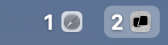

# aerospace-swiftbar

A [SwiftBar](https://github.com/swiftbar/SwiftBar) menu bar plugin for the [AeroSpace](https://github.com/nikitabobko/AeroSpace) window manager. It shows each non-empty workspace with the icons of the apps on it, and highlights the focused one.



Click the menu bar item to see each workspace with its app names, and click a workspace to switch to it.

## Requirements

- macOS with AeroSpace (`aerospace` CLI in `/opt/homebrew/bin`)
- SwiftBar: `brew install --cask swiftbar`

The icon strip is drawn with AppKit via JavaScript for Automation (`osascript`), so nothing else is needed.

## Install

```bash
git clone https://github.com/yepesasecas/aerospace-swiftbar.git ~/Repos/aerospace-swiftbar
mkdir -p ~/swiftbar
ln -s ~/Repos/aerospace-swiftbar/aerospace.10s.sh ~/swiftbar/aerospace.10s.sh
ln -s ~/Repos/aerospace-swiftbar/.render-bar.js ~/swiftbar/.render-bar.js
```

Then pick `~/swiftbar` as SwiftBar's plugin folder. Symlink only these two files; SwiftBar runs every non-hidden file in that folder as a plugin.

To refresh immediately on workspace switch, not just every 10 seconds, add this to `~/.aerospace.toml`:

```toml
exec-on-workspace-change = ['/bin/bash', '-c',
  'open -g "swiftbar://refreshplugin?name=aerospace"'
]
```

AeroSpace's own menu bar icon becomes redundant; hide it in System Settings → Menu Bar.

## Options

In `aerospace.10s.sh`:

- `ICONS=mono` draws grayscale icons; `ICONS=color` keeps the original app colors.
- `mode=dark` draws white labels with a soft shadow, which reads on both light and dark menu bars. Set `mode=light` for black labels.

## License

MIT
